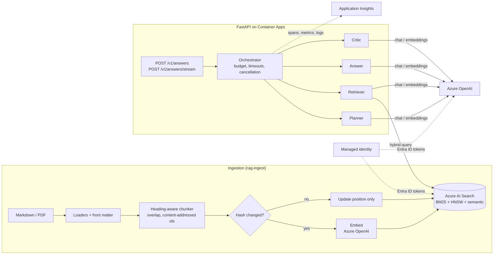
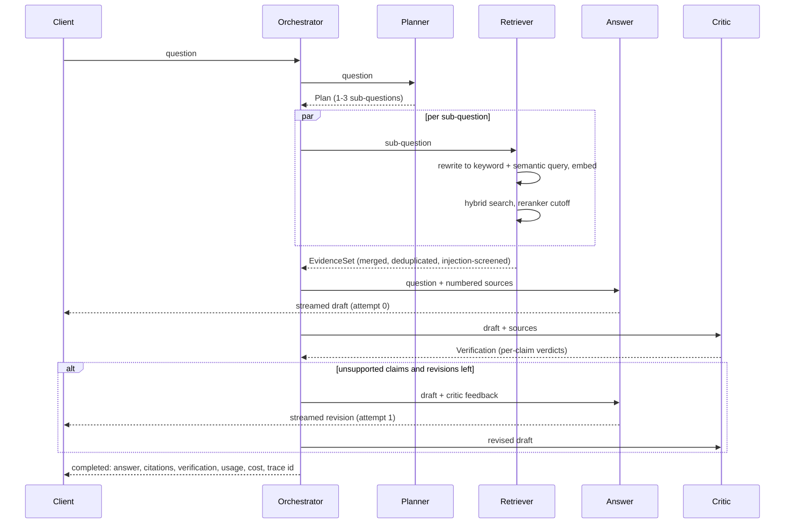

# Azure AI Multi Agent RAG Platform

An internal knowledge assistant that answers employees' questions about procurement, tax,
finance and ERP policies, with inline citations to the exact policy section. It is built
on Azure OpenAI and Azure AI Search, with explicit multi-agent orchestration, OpenTelemetry
tracing, per-request cost accounting and an evaluation suite that can gate CI.

> **Portfolio project.** This is not deployed anywhere and has not served real users.
> The company in the sample documents ("Halvorsen Industries") is fictitious. Everything
> runs locally against fakes; the Azure paths are implemented against the official SDKs
> and validated with mocked HTTP and Bicep compilation, not against live resources.
> No quality or performance numbers are claimed beyond what is stated in
> [docs/EVALUATION.md](docs/EVALUATION.md).

## The problem

Finance and procurement policies are long, change every year, and are spread across
SOPs, ERP guides and wiki pages. Employees ask narrow questions ("who approves a $72k
PO?", "what do we withhold for a foreign consultant without a W-8BEN?") and need an answer
they can act on and verify. A plain chat model answers fluently but invents thresholds. A
basic RAG pipeline helps, but it still:

- misses half of multi-part questions because one search only covers one part;
- cites sources that do not say what the answer claims;
- follows instructions planted in retrieved documents;
- has no budget, timeout or cost visibility per request.

This project addresses each of those points explicitly.

## Architecture



| Path | Responsibility |
| --- | --- |
| `src/rag_platform/agents/` | Planner, retriever, answer and critic agents, typed messages, token budget, orchestrator |
| `src/rag_platform/clients/` | Protocols plus Azure OpenAI, Azure AI Search and in-memory adapters |
| `src/rag_platform/ingestion/` | Loaders, chunker, index schema, idempotent index sync, `rag-ingest` CLI |
| `src/rag_platform/safety/` | Prompt-injection defenses, PII redaction, content filter handling |
| `src/rag_platform/telemetry/` | GenAI-convention spans and metrics, JSON logs, cost ledger, Azure Monitor setup |
| `src/rag_platform/evaluation/` | Golden set, metrics, LLM judge, runner, report, `rag-eval` CLI |
| `src/rag_platform/api.py` | FastAPI app factory with JSON and SSE endpoints |
| `infra/` | Bicep: OpenAI and deployments, AI Search, Container Apps, monitoring, identity and RBAC |
| `evals/` | Golden dataset, versioned judge rubrics, quality thresholds |
| `data/sample_corpus/` | Nine fictitious policy documents |

## Agent flow



1. **Planner** (`gpt-4o-mini`) splits the question into up to three self-contained
   sub-questions. Invalid output falls back to the original question: planning improves
   recall but is not required for an answer.
2. **Retriever** rewrites each sub-question into a keyword query (with ERP and finance
   acronyms expanded) and a natural-language query, then runs one hybrid query per
   sub-question concurrently: BM25 on the keyword query, vector search on the embedded
   semantic query, Reciprocal Rank Fusion, then the semantic ranker. Hits below a
   reranker score cutoff are dropped, results are interleaved round-robin across
   sub-questions so each one is represented, and suspicious chunks are withheld.
3. **Answer** drafts from numbered `<source>` blocks only, with a `[n]` citation on every
   factual sentence. If retrieval returned nothing, generation is skipped and the service
   says the policy library does not cover the question.
4. **Critic** splits the draft into claims and checks each against the sources it cites.
   Deterministic checks run alongside the model: citation numbers that do not exist and
   factual sentences without any citation are always unsupported, so a persuasive but
   uncited draft cannot pass. Any unsupported claim triggers **one** revision with the
   critic's feedback, and the revision is verified again.

Every hand-off is an immutable Pydantic model (`Plan`, `EvidenceSet`, `Draft`,
`Verification`, `AnswerResult`), so each agent can be tested and traced on its own.

### Request guardrails

- **Token budget per request** (`REQUEST_TOKEN_BUDGET`). Each model call reserves its
  worst case (estimated prompt plus `max_output_tokens`) before it is sent, and the
  reservation is replaced by actual usage afterwards. Reserving up front keeps the budget
  correct while the retriever runs calls in parallel. When the budget runs out, the
  newest verified draft is returned with `status: "budget_exhausted"`.
- **Timeouts** per agent step and per request, with `asyncio.timeout`.
- **Cancellation.** The streaming endpoint runs the pipeline in a task. If the client
  disconnects, the task is canceled, which cancels in-flight model and search calls.
- **Outcomes, not exceptions.** `status` is one of `answered`, `insufficient_evidence`,
  `blocked`, `budget_exhausted` or `timeout`. `grounded` is true only when the returned
  answer was verified and every claim is supported.

## Design decisions

- **No agent framework.** The flow is four agents and one bounded loop. Plain async
  Python keeps every transition visible in one function, makes the budget and
  cancellation semantics exact, and avoids a dependency whose abstractions would need
  to be learned and then worked around.
- **Protocols around the SDKs.** Agents depend on `ChatModel`, `Embedder`,
  `SearchBackend` and `IndexStore`. The Azure adapters are thin; tests use fakes, and the
  OpenAI adapter is additionally tested with the real SDK over a mocked HTTP transport.
- **Instrumentation as a decorator.** `InstrumentedChatModel` wraps any `ChatModel`, so
  fakes and production emit identical spans and the span contract is asserted in tests.
- **Cheap model for routing work.** Planning, query rewriting and verification run on
  `gpt-4o-mini`; only the answer uses `gpt-4o`. All deployment names are configurable.
- **Client-side embeddings.** Queries are embedded in the retriever rather than by a
  search-side vectorizer, so the same text is visible in traces, counted in the budget
  and testable without Azure.
- **Reranker score as the relevance cutoff.** The semantic ranker score (0 to 4) is
  comparable across queries, unlike fused RRF scores, so it is the right signal for
  "nothing relevant was found".
- **Heading-aware, content-addressed chunks.** Chunks never cross a heading, carry their
  heading path, and are embedded with it. Chunk ids are hashes of the embedded text plus
  the embedding model and dimensions, so re-ingesting an edited policy re-embeds only the
  changed sections, deletes stale ones, and a model change re-embeds everything.
- **Streaming with revisions.** Draft tokens stream immediately for perceived latency.
  Each delta carries an `attempt` number; if the critic triggers a revision, clients
  replace the earlier attempt. The final `completed` event is authoritative.
- **Versioned index name.** Breaking schema changes (vector dimensions, analyzers) go to a
  new index (`policies-v2`) that is filled and evaluated before the app is switched over.

## Safety

- **Indirect prompt injection.** Retrieved text is wrapped in `<source>` elements with
  escaped attributes. Tag-like sequences inside chunks are neutralized so a document cannot
  close its element or forge a system block. System prompts state an explicit instruction
  hierarchy and treat source content as data. Chunks matching common injection phrasings
  are withheld and logged. In production, Azure AI Content Safety Prompt Shields (document
  attack detection) is the stronger complement to these heuristics.
- **Content filters.** Azure OpenAI prompt rejections (HTTP 400 `content_filter`) and
  filtered completions (`finish_reason: content_filter`) are normalized into
  `ContentFilteredError`. The API returns `status: "blocked"` with a neutral message, and the
  filtered categories are recorded on the span.
- **PII in telemetry.** Emails, phone numbers, IBANs, US SSNs and Luhn-valid card numbers
  are masked in every log record when it is created, before any exporter sees it.
  Purchase order and invoice numbers are deliberately left intact.
- **No keys in Azure.** OpenAI and Search have local auth disabled. The API uses a
  user-assigned managed identity with inference-only and query-only roles.

## Telemetry and cost

- A `rag.request` span per request, an `invoke_agent <name>` span per agent step and a
  `chat <deployment>` / `embeddings <deployment>` client span per model call, with GenAI
  semantic-convention attributes: `gen_ai.request.model`, `gen_ai.response.model`,
  `gen_ai.usage.input_tokens`, `gen_ai.usage.output_tokens`, finish reasons, plus time to
  first token for streams.
- Histograms `gen_ai.client.operation.duration` and `gen_ai.client.token.usage`.
- A cost ledger per request, priced from a configurable table (`MODEL_PRICES`). Total
  tokens and USD cost are returned in the response and set on the root span. Deployments
  without a price are reported in `warnings` instead of failing the request.
- With `APPLICATIONINSIGHTS_CONNECTION_STRING` set, the Azure Monitor OpenTelemetry distro
  exports traces, metrics and logs, and auto-instruments FastAPI and outgoing HTTP.

## Evaluation

The suite scores each layer separately: deterministic retrieval metrics (recall@k, MRR),
citation precision and recall, LLM-as-judge groundedness and answer relevance with
versioned rubrics, and abstention on out-of-scope questions. `rag-eval` writes a Markdown
report and exits non-zero when a threshold in `evals/thresholds.toml` is missed.
See [docs/EVALUATION.md](docs/EVALUATION.md) for the design, the dataset and its limits.

## Running locally

Requirements: Python 3.12 and [uv](https://docs.astral.sh/uv/).

```bash
uv sync
uv run ruff check . && uv run ruff format --check .
uv run mypy
uv run pytest

# No Azure needed:
uv run rag-ingest --dry-run                              # load and chunk the sample corpus
uv run rag-eval --mode retrieval --offline               # BM25 retrieval baseline report
```

With Azure resources (see below), copy `.env.example` to `.env`, fill in the endpoints and
either sign in with `az login` (Entra ID) or set API keys for developer resources:

```bash
uv run rag-ingest --corpus data/sample_corpus            # create the index and upload chunks
uv run uvicorn rag_platform.api:create_app --factory --reload

curl -s localhost:8000/v1/answers -H 'content-type: application/json' \
  -d '{"question": "Who approves a $72,000 purchase order?"}'
curl -N localhost:8000/v1/answers/stream -H 'content-type: application/json' \
  -d '{"question": "What do we withhold for a foreign consultant without a W-8BEN?"}'

uv run rag-eval --mode full                              # end-to-end evaluation with LLM judge
```

## Deploying to Azure

```bash
az group create -n rg-rag-platform -l eastus2
az deployment group create -g rg-rag-platform -f infra/main.bicep \
  -p deployerPrincipalId=$(az ad signed-in-user show --query id -o tsv)

# Build and push the image, then point the app at it.
az acr build -r <registryLoginServer without .azurecr.io> -t rag-platform:1 .
az deployment group create -g rg-rag-platform -f infra/main.bicep \
  -p deployerPrincipalId=... containerImage=<registryLoginServer>/rag-platform:1
```

The first deployment runs a public placeholder image because the new registry is empty.
Model availability and quota differ per region; adjust `openAiLocation` and
`modelDeployments` as needed. With `externalIngress=true`, enable Container Apps
authentication (Entra ID) or put an API gateway in front before exposing the service.

## Continuous integration

`.ci/workflow.yml` runs Ruff, strict mypy, pytest and the offline retrieval baseline with
the locked dependency set, and compiles and lints the Bicep templates. None of these steps
needs Azure credentials. The full evaluation suite is designed to run in a separate,
credentialed job (see [docs/EVALUATION.md](docs/EVALUATION.md#quality-gates)).
