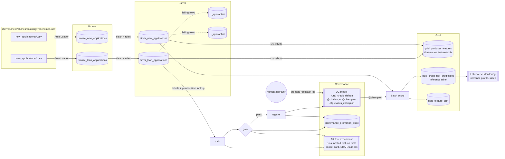

# Architecture

## Lakehouse and job graph



## Jobs

| Job | Tasks | Trigger |
|---|---|---|
| `credit-risk-training` | ingest_bronze -> build_silver -> publish_features -> train -> evaluate_gate -> gate_passed (condition) -> register | weekly |
| `credit-risk-batch-scoring` | ingest_bronze -> build_silver -> publish_features -> batch_score | daily |
| `credit-risk-promote` | promote or roll back `@champion` with a named approver | on demand |
| `credit-risk-seed-demo-data` | write synthetic CSVs to the landing volume (refuses `prod*` catalogs) | on demand |

Tasks hand data to each other only through Delta tables and MLflow. The one
exception is the training `run_id` (and the boolean gate result), passed as job
task values. The register task still re-reads the gate decision from the run
instead of trusting the task value.

## Code layout and the Spark boundary

```
src/credit_risk/
  config.py, schemas.py, domain.py   feature contract, UC names, DDL
  data/synthetic.py                  generator with documented, injected bias
  quality/                           cleaning + declarative rules (pandas)
  features/transforms.py             producer/loan features, point-in-time join
  training/                          LightGBM pipeline, temporal split, Optuna, pyfunc
  responsible_ai/                    fairness, calibration, mitigation, SHAP, model card
  governance/                        policy loader, gate, audit rows, registry aliases
  monitoring/drift.py                PSI
  pipeline.py                        stage functions shared by notebooks and the CLI
  tracking.py                        MLflow logging conventions
  cli.py                             local end-to-end runner (SQLite MLflow)
  lakehouse/                         the only Spark / Delta / FE / SDK code
```

Everything outside `lakehouse/` runs on pandas and is covered by unit tests.
Spark executes the same row-local pandas functions through `mapInPandas`, so
cleaning, validation, and feature logic have a single implementation. Only
operations that are not partition-local (deduplication by `loan_id`, feature
table primary-key dedup) are written in Spark.

## Design decisions

- **Point-in-time features.** `gold_producer_features` is keyed by
  `(producer_id, as_of_date)` with `as_of_date` as a timestamp key. Training
  uses `FeatureLookup(timestamp_lookup_key="application_date")`, so a loan never
  sees producer data recorded after its application.
- **Temporal holdout.** The most recent 20% of applications form the holdout.
  The candidate and the champion are compared on that same holdout, and its
  feature distribution is compared with the training window via PSI.
- **Probability, not label, is served.** A pyfunc wrapper returns
  `default_probability`; the decision threshold lives in the versioned policy
  and is applied downstream, so changing the operating point is a governed
  change, not a retrain.
- **Aliases only.** Model stages are not used (deprecated, and unsupported in
  Unity Catalog). Promotion is one alias update; rollback is moving `@champion`
  back to `@previous_champion`.
- **Two locks on promotion.** The job graph only runs `register` after a passing
  gate, and `register_challenger` / `promote_to_champion` independently refuse
  versions without a passing, tagged gate decision.
- **Full silver rebuild.** Silver and quarantine are rebuilt from bronze on each
  run. That keeps tasks idempotent and lets a corrected rule release rows from
  quarantine. At larger volume, switch to Change Data Feed + `MERGE`.
- **Monitor created by the job.** A Lakehouse Monitor can only attach to an
  existing table, and the inference table appears after the first scoring run,
  so `ensure_inference_monitor` creates it idempotently rather than the bundle.

## Environments

| Target | Catalog | Schema | `@champion` moves |
|---|---|---|---|
| dev | `dev_credit` | `credit_risk_<user>` | automatically after a passing gate |
| staging | `staging_credit` | `credit_risk` | automatically after a passing gate |
| prod | `prod_credit` | `credit_risk` | only via `credit-risk-promote` with a named approver |

The serving endpoint is declared for staging and prod only. Serving endpoints
reference a concrete model version (they cannot resolve aliases), and creating
one fails until that version exists. This is a known bootstrap ordering problem:
on a brand-new staging or prod catalog, the first deploy has to go out without
the endpoint block, the training job then registers a version, and the next
deploy (with `--var serving_model_version=<n>`) creates the endpoint. After
that, each promotion is followed by a deploy that bumps `serving_model_version`. Serving a model logged with
Feature Engineering also requires `gold_producer_features` to be published to
an online store; that is not provisioned here.
