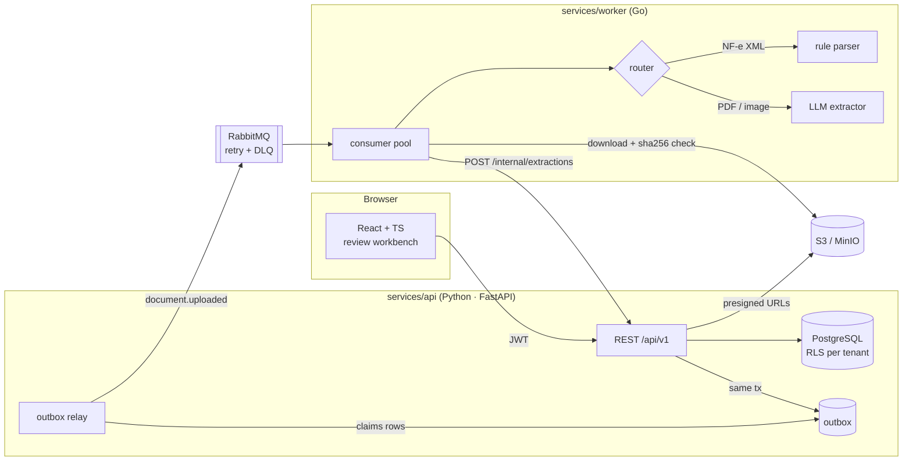

# LedgerFlow

AI-assisted document intake for ERP modernization.

Finance teams still key supplier invoices into legacy ERPs by hand. LedgerFlow takes the upload, extracts
the fields (deterministically for Brazilian NF-e XML, with an LLM for PDFs and scans), sends only the
low-confidence documents to a human review queue, and keeps a full audit trail of every change.



## Repository layout

| Path | What | Stack |
|---|---|---|
| [`apps/web`](apps/web) | Review workbench, document list, dashboard, in-house component library | React 18, TypeScript, TanStack Query, React Hook Form + Zod, Storybook, Vitest, MSW |
| [`services/api`](services/api) | REST API, auth/RBAC, state machine, audit, outbox relay | FastAPI, SQLAlchemy 2 (async), Alembic, PostgreSQL 16, aio-pika |
| [`services/worker`](services/worker) | Queue consumer, NF-e parser, LLM extraction, cost tracking | Go 1.23, amqp091-go, aws-sdk-go-v2, Prometheus |
| [`docs/CONTRACTS.md`](docs/CONTRACTS.md) | API, message and schema contracts shared by all three | |
| [`docs/adr`](docs/adr) | Architecture decision records | |

## Document lifecycle

```
uploaded → queued → processing → extracted ───────────→ approved → exported
                         │            └→ needs_review → approved | rejected
                         └→ failed (after retries → DLQ; admin can re-queue)
```

A document is auto-approvable only when every field meets the tenant's confidence threshold.
Human corrections never overwrite: they create a new extraction version with `source = "human"`.

## Design decisions

| Decision | Why | ADR |
|---|---|---|
| Transactional outbox + idempotent consumers | No dual-write between Postgres and RabbitMQ; at-least-once delivery is safe | [0001](docs/adr/0001-transactional-outbox.md) |
| Rules before LLM | NF-e is structured XML — parsing it is free and deterministic; LLM output is validated, never trusted | [0002](docs/adr/0002-rules-before-llm.md) |
| PostgreSQL Row-Level Security | A missing tenant filter fails closed instead of leaking another company's invoices | [0003](docs/adr/0003-tenant-isolation.md) |
| In-house component library | The workbench is used all day; keyboard flow and density beat a generic UI kit | [0004](docs/adr/0004-in-house-design-system.md) |

Other choices worth noting:

- **Money is a decimal string end to end** — `Decimal` in Python, `shopspring/decimal` in Go, a small
  string-decimal util in TypeScript. No floats touch amounts.
- **Optimistic locking** — documents carry a `version`; mutations require `If-Match` and return `412` on
  conflict, which the UI resolves with a reload dialog instead of last-write-wins.
- **Errors as RFC 9457 problem+json** with a `request_id` that is also propagated to the worker through
  W3C `traceparent`.
- **Cost visibility** — every LLM extraction records model, prompt version, latency and cost in micro-USD,
  aggregated on the dashboard.

## Running locally

Requires Docker, plus Node 20+, Python 3.12+ and Go 1.23+ for working on individual services.

```bash
cp .env.example .env            # set OPENAI_API_KEY for the worker
docker compose up --build
docker compose exec api ledgerflow-seed
```

| Service | URL |
|---|---|
| Web | http://localhost:8080 |
| API docs (OpenAPI) | http://localhost:8000/docs |
| RabbitMQ console | http://localhost:15672 |
| MinIO console | http://localhost:9001 |

Seeded users (`admin@demo.example.com`, `reviewer@demo.example.com`, `viewer@demo.example.com`) share `SEED_PASSWORD` from `.env`.

The web app can also run with no backend at all: `cd apps/web && npm run dev:mocks`
serves the UI against MSW mock handlers.

## Tests

```bash
make test        # all three services
make lint
```

Each service README describes its own test setup.

## Status

Portfolio project. It exercises the patterns I use on production systems — outbox, RLS, optimistic
locking, LLM output validation, an accessible component library — on a realistic ERP-modernization domain.
It is not deployed anywhere.
