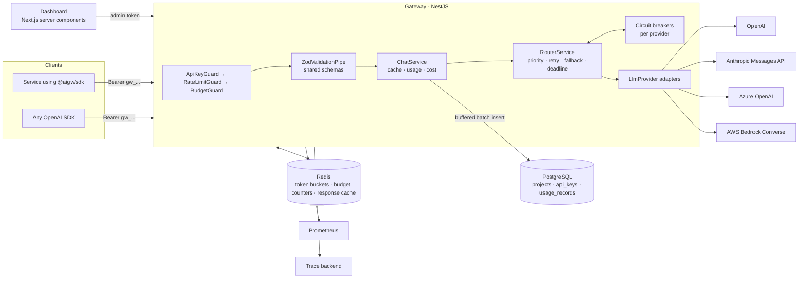

# NestJS AI Gateway and Next.js Dashboard

A TypeScript-first LLM gateway: one OpenAI-compatible API in front of OpenAI, Anthropic, Azure
OpenAI and AWS Bedrock, with alias-based routing and fallback, per-key rate limits and budgets, cost
tracking, a typed SDK, and an admin dashboard.

> **Portfolio project.** This is not deployed anywhere and has not served production traffic. There
> are no benchmarks or usage numbers in this README because none exist. The test suite and the build
> are what is verified; see [What is and isn't verified](#what-is-and-isnt-verified).

## The problem

Teams that call several LLM providers tend to re-implement the same concerns in every service:
provider SDK differences, retries, failover when one provider rate-limits or goes down, API key
sprawl, and the question "what did we spend, and on what?". A gateway centralizes that:

- Clients speak **one wire format** (OpenAI's, so existing SDKs work unchanged) and ask for an
  **alias** such as `fast` or `smart`, never a provider model ID.
- Operators decide in **one typed config file** which provider/model serves each alias, in what
  order, and at what price.
- Every request is **authenticated, rate-limited, budget-checked, priced and logged** in the same
  place.

## Repository layout

```
apps/gateway      NestJS 11 service: /v1 (OpenAI-compatible), /admin, /metrics, /healthz, /readyz
apps/dashboard    Next.js 15 App Router admin UI (server components + server actions)
packages/shared   zod schemas and types shared by everything (wire format, admin DTOs, config, SSE)
packages/sdk      fetch-based typed client: chat, streaming, admin; retries and typed errors
```

## Architecture



The gateway is a set of focused Nest modules wired with DI: `ConfigModule` (validated env and route
config), `ObservabilityModule` (pino, Prometheus, tracing lifecycle), `AuthModule`, `LimitsModule`,
`ProvidersModule`, `RoutingModule`, `UsageModule`, `ChatModule` and `AdminModule`. Cross-cutting
behavior uses Nest primitives: guards for auth and limits, a pipe for validation, a global exception
filter for OpenAI-style errors, and a global interceptor for request metrics.

## Request lifecycle

For `POST /v1/chat/completions`:

1. **Request ID.** `x-request-id` is accepted if well-formed (to propagate IDs across services) or
   generated, echoed back, and attached to every log line and trace span.
2. **Authenticate** (`ApiKeyGuard`). Keys look like `gw_<prefix>_<secret>`. The prefix is a unique,
   non-secret lookup handle; the stored value is `HMAC-SHA256(pepper, key)`, compared in constant
   time. Lookups are cached for `API_KEY_CACHE_TTL_MS`.
3. **Rate limit** (`RateLimitGuard`). A token bucket per key, evaluated by one Lua script in Redis.
   Denials return `429 rate_limit_exceeded` with `Retry-After`.
4. **Budget** (`BudgetGuard`). Month-to-date spend is compared with the key's monthly budget;
   exhausted budgets return `429 insufficient_quota`, the same code OpenAI uses.
5. **Validate** (`ZodValidationPipe`) against `chatCompletionRequestSchema` from `@aigw/shared`.
   Unknown aliases return `404 model_not_found`.
6. **Cache** (optional). Temperature-0, non-streaming requests are looked up by a hash of the
   canonicalized request, scoped per project.
7. **Route** (`RouterService`), see below. The client's disconnect is propagated to the upstream
   request through an `AbortController`.
8. **Respond.** JSON, or SSE with backpressure (`write()` → wait for `drain`) and `[DONE]`.
   Responses carry `x-gateway-provider`, `x-gateway-model`, `x-gateway-attempts` and
   `x-gateway-cache`.
9. **Account.** Tokens come from the provider's own usage report; cost is computed from the price
   table. The Redis budget counter is incremented immediately; the usage row is queued and written
   in batches.

## Routing and fallback semantics

Routes live in [`apps/gateway/src/config/gateway.config.ts`](apps/gateway/src/config/gateway.config.ts):

```ts
smart: {
  description: 'Highest-quality models for complex reasoning and tool use.',
  targets: [
    { provider: 'anthropic', model: 'claude-sonnet-4-5' },
    { provider: 'openai', model: 'gpt-4o' },
    { provider: 'azure-openai', model: 'gpt-4o' }, // Azure: deployment name
  ],
},
```

The config is validated at startup with the shared zod schema, plus a cross-check that **every
target has a price**: an unpriced target would be recorded as free and silently bypass budgets, so
the process refuses to start instead.

For each target in priority order:

| Upstream outcome                             | Kind            | Same-target retry | Fall back | Counts toward breaker |
| -------------------------------------------- | --------------- | ----------------- | --------- | --------------------- |
| 5xx (incl. Anthropic 529), malformed payload | `server`        | yes               | yes       | yes                   |
| No response within `attemptTimeoutMs`        | `timeout`       | yes               | yes       | yes                   |
| Connection error                             | `network`       | yes               | yes       | yes                   |
| 429                                          | `rate_limit`    | no                | yes       | yes                   |
| 401 / 403 / 404 (bad key, unknown model)     | `misconfigured` | no                | yes       | yes                   |
| Other 4xx                                    | `client`        | no                | **no**    | no                    |
| Client disconnects                           | -               | no                | **no**    | no                    |

- **Retries** use full-jitter exponential backoff (`random(0, min(max, base·2ⁿ))`), which spreads
  synchronized retries instead of hammering a recovering provider. 429s skip same-target retries
  because rate limits rarely clear within milliseconds; moving down the chain is faster.
- **Client errors stop routing.** A 400 would fail identically everywhere, so fallback would only
  multiply latency and cost.
- **Circuit breaker per provider**: after `failureThreshold` consecutive provider faults the circuit
  opens and the provider is skipped (costing callers nothing) for `cooldownMs`; then a single
  half-open probe decides whether it closes or reopens. Neutral outcomes release the probe slot.
- **Deadline per attempt.** Each attempt gets its own timer linked to the client's signal with
  `AbortSignal.any`. The timer is cleared once the attempt succeeds, so it bounds time-to-first-chunk
  for streams without cutting off long generations.
- **Streams commit on the first chunk.** The router pulls the first chunk inside the attempt, so
  connection errors, early 429s and early stream errors still fall back. After the first byte is on
  the wire the status code cannot change; later failures are sent in-band as an OpenAI-style error
  event, which the SDK surfaces as `StreamError`.
- **Exhaustion** maps to the last failure: `429 upstream_rate_limited`, `504 upstream_timeout`, or
  `502 upstream_unavailable`; `503 no_available_provider` when every target was skipped.

## Provider abstraction

Each adapter implements one interface ([`llm-provider.ts`](apps/gateway/src/providers/llm-provider.ts))
in the OpenAI wire format, with a few obligations the router relies on: `complete()` returns usage;
`stream()` performs no I/O until first iterated and always finishes with one usage-only chunk; HTTP
and network failures are thrown as `UpstreamError` with a routing `kind`.

- **OpenAI / Azure OpenAI** share `OpenAiCompatibleProvider`. Azure differs only in addressing
  (deployment in the URL, `api-version` query) and the `api-key` header. Upstream payloads are
  re-validated with the shared schemas, which also normalizes Azure's prompt-filter chunks away.
  `stream_options.include_usage` is always requested upstream; the usage chunk is forwarded to the
  client only if it asked for it.
- **Anthropic (Messages API)**, translated in [`anthropic.mapper.ts`](apps/gateway/src/providers/anthropic/anthropic.mapper.ts):
  system/developer messages move to the top-level `system` field; `tool` messages become
  `tool_result` blocks inside user turns and consecutive same-role turns are merged (Anthropic
  requires alternation); assistant `tool_calls` become `tool_use` blocks; `tool_choice` maps
  `required → any`; data-URL images become base64 sources; `max_tokens` gets a configured default
  because Anthropic requires it; temperature is clamped to Anthropic's 0-1 range. The stream
  translator is a small state machine: content-block indexes are remapped to OpenAI tool-call
  indexes, `input_json_delta` becomes argument deltas, and usage from `message_start` (input,
  including cache reads/writes) and `message_delta` (output) is merged into the final chunk.
- **AWS Bedrock (Converse API)** via `@aws-sdk/client-bedrock-runtime`. Converse is model-agnostic,
  so one mapping covers every Converse-capable model. SDK-level retries are disabled
  (`maxAttempts: 1`) so the router stays the single owner of retry policy and the breaker sees every
  failure. Usage arrives in the trailing `metadata` event.

## Cost tracking and budgets

- **Tokens** always come from the provider's usage report, never from a local tokenizer estimate.
  Anthropic and Bedrock cache read/write tokens are counted as input.
- **Cost** = `prompt × input price + completion × output price` (per million tokens), rounded to 8
  decimal places to match `usage_records.cost_usd NUMERIC(14,8)`.
- **Persistence** is write-behind: `UsageRecorder` buffers rows in memory and flushes them with one
  `createMany` when the batch fills or every `USAGE_FLUSH_INTERVAL_MS`, and drains on graceful
  shutdown. A failed flush is requeued; the buffer is bounded and overflow is dropped and counted
  (`gateway_usage_records_dropped_total`) so a database outage degrades reporting, not latency.
- **Budgets** read a Redis counter per key and month, seeded from PostgreSQL on first use and
  incremented as each request completes. Budgets are soft: requests already in flight when the limit
  is crossed may finish.
- One `usage_records` row per client request (not per attempt), with the final provider/model,
  attempts, latency, cache/stream flags and error code. Per-attempt detail lives in metrics.

## Observability

- **Logs**: pino JSON via `nestjs-pino`, one line per request with the request ID; credentials and
  cookies are redacted; when tracing is on, each line carries `trace_id`/`span_id`.
- **Traces**: OpenTelemetry Node SDK, enabled only when `OTEL_EXPORTER_OTLP_ENDPOINT` is set (HTTP,
  Express and Nest instrumentations plus an explicit span per upstream attempt with `gen_ai.*`
  attributes).
- **Metrics** at `GET /metrics` (prom-client, dedicated registry): request duration, upstream
  attempts by outcome, upstream latency, fallbacks, tokens, cost, circuit state, rejections by
  reason, cache lookups, usage buffer size and drops. Labels never include key or request IDs, to
  keep cardinality bounded; per-tenant analysis belongs in the database.
- **Health**: `/healthz` (liveness) and `/readyz` (database required; Redis reported as degraded but
  not required, since rate limiting and caching fail open).

## Admin API and dashboard

All `/admin` routes require `Authorization: Bearer $ADMIN_TOKEN`:

| Endpoint                                               | Purpose                                                   |
| ------------------------------------------------------ | --------------------------------------------------------- |
| `GET /admin/usage/summary?from&to`                     | totals, error rate, cache hits, p95 latency               |
| `GET /admin/usage/timeseries?from&to`                  | per-day requests, errors, spend, p95 (gaps filled)        |
| `GET /admin/usage/providers?from&to`                   | requests, error rate, spend, p95 per provider             |
| `GET /admin/usage/aggregate?groupBy=key\|model\|day`   | spend and tokens grouped by key, model or day             |
| `GET /admin/requests?apiKeyId&provider&alias&status`   | request log, keyset-paginated (`cursor`, `limit`)         |
| `GET /admin/routes`                                    | aliases, targets, prices, provider enabled, circuit state |
| `GET/POST /admin/keys`, `PATCH/DELETE /admin/keys/:id` | list, create (plaintext returned once), update, revoke    |

Aggregations run in PostgreSQL (`percentile_cont`, `FILTER`) over indexed time ranges; p95 excludes
cached and failed requests, which would otherwise pull it toward zero or toward the timeout.

The dashboard renders with server components that call the admin API through the SDK. The admin
token is verified against the gateway by a login server action and stored in an `httpOnly`,
`SameSite=Strict` cookie; it never reaches browser JavaScript. Pages: **Overview** (spend, requests,
p95 latency per day, error rate by provider; each chart has a table view), **API keys** (create with a
show-once secret, revoke with confirmation), **Models & routes** (chain order, prices, circuit state)
and **Request log** (filters in the URL, keyset pagination).

## Design decisions

- **OpenAI wire format as the canonical model.** Clients get compatibility for free, and every
  adapter has exactly one translation to own. The cost is that provider-specific features without
  an OpenAI equivalent (e.g. Anthropic extended thinking) are not exposed.
- **Aliases only, no raw model IDs from clients.** Model choice becomes an operator decision that can
  change without client deploys, and pricing/budget coverage is guaranteed by config validation.
- **Shared zod schemas in one package.** The gateway validates with the same schemas the SDK and
  dashboard compile against, so a contract change is a compile error on both sides.
- **fetch-based adapters for OpenAI/Azure/Anthropic** instead of vendor SDKs: precise control over
  abort, streaming and error classification, and one SSE parser shared with the SDK. Bedrock uses
  the AWS SDK because SigV4 signing and the event-stream encoding are not worth re-implementing.
- **Fail open on Redis** for rate limits and cache: a Redis blip should not take the API down. Spend
  stays bounded by budgets, whose counter falls back to the database when Redis is unavailable.
- **In-process circuit breakers.** Each replica judges providers from its own network vantage point,
  and the hot path avoids a Redis round trip per attempt.
- **Write-behind usage logging.** The request path never waits on PostgreSQL; the trade-off is that
  a crash can lose up to one flush interval of rows (budget counters are already updated).
- **HMAC-SHA256 with a pepper for keys**, not bcrypt/argon2: keys carry 256 bits of entropy, so a slow
  KDF adds latency without adding security; the pepper keeps a leaked table from being useful alone.

### Known limitations

- A stream the client abandons before the final usage event is recorded with zero tokens, because
  providers report usage at the end of the stream.
- `n > 1`, `response_format`, logprobs and audio/vision outputs are not supported.
- Revocations take up to `API_KEY_CACHE_TTL_MS` to reach other replicas.
- Prices in `gateway.config.ts` are illustrative and must be checked against each provider's current
  pricing before relying on the cost figures.

## Running it

Requirements: Node 24 and npm 11. PostgreSQL 16+ and Redis 7+ (or Docker for the compose stack).

```bash
npm install
npm run prisma:generate

# Option A: everything in Docker
cp .env.example .env            # set ADMIN_TOKEN, API_KEY_PEPPER and at least one provider key
docker compose up --build       # gateway :3000, dashboard :3001

# Option B: local processes (PostgreSQL and Redis already running)
cp .env.example apps/gateway/.env
cp apps/dashboard/.env.example apps/dashboard/.env.local
npm run build:packages
npm run prisma:migrate -w @aigw/gateway
npm run dev -w @aigw/gateway    # http://localhost:3000
npm run dev -w @aigw/dashboard  # http://localhost:3001
```

Sign in to the dashboard with `ADMIN_TOKEN`, create a key on the **API keys** page, then:

```bash
curl -N http://localhost:3000/v1/chat/completions \
  -H "authorization: Bearer gw_..." -H "content-type: application/json" \
  -d '{"model":"fast","stream":true,"messages":[{"role":"user","content":"Hello"}]}'
```

### Quality checks

```bash
npm run typecheck   # builds shared + sdk, then tsc in every workspace
npm run lint        # ESLint flat config, type-aware rules
npm test            # Vitest in every workspace
npm run build       # shared, sdk, gateway (tsc), dashboard (next build)
```

CI runs the same steps (`.ci/workflow.yml`).

## What is and isn't verified

Verified locally (Windows, Node 24): install, Prisma client generation, typecheck, lint, Prettier,
all unit and HTTP-level tests, the gateway and dashboard production builds, and a boot of the built
gateway (health, metrics, auth rejection and admin routes respond correctly without a database).

Not verified: calls against real provider APIs (no credentials were used; adapters are tested
against hand-written fixtures of the documented wire formats), the Docker images and compose stack (Docker was not
available), and the SQL analytics queries against a live PostgreSQL instance (the migration was
generated by Prisma from the schema, but not applied).
